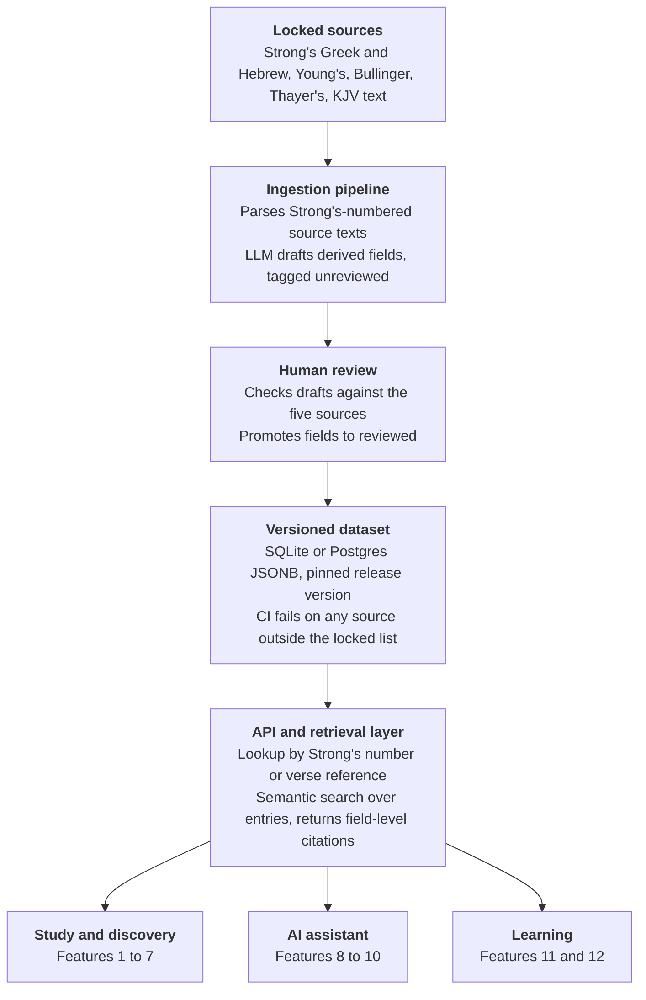
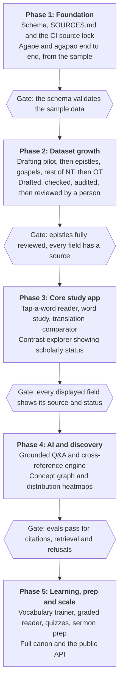

# Biblical Word-Study App: Features and Workflows

Last updated: 2026-11-03

## Vision and scope

The app lets a reader start from any Bible verse and see the Greek or Hebrew behind every English word, with lexicon definitions, Septuagint background, scholarly caveats and an AI assistant that cites the exact data it used. It is built on one structured dataset covering every word and every verse, keyed by Strong's number, so each feature is a different view of the same graph.

**Who it serves**

- Pastors and teachers preparing sermons and lessons
- Seminary and Bible-college students doing word studies and exegesis papers
- Lay readers who want to know what "love" or "charity" translates
- Greek and Hebrew learners building vocabulary and reading skill
- Researchers and developers who want the data through an API

**What it is not**

- Not a devotional or commentary app. It surfaces language data and scholarly status, and leaves doctrine to the reader.
- Not a replacement for BDAG, HALOT or a trained exegete. Older public-domain lexicons are the baseline and are labeled as such.
- Not an AI that answers from memory. Every AI answer is grounded in retrieved entries and shows its sources.

## Core data model

Every feature reads from one graph of eight entity types, keyed by Strong's number. The attached sample (`data/samples/agape_agapao_lexical_sample.json`) already holds the lexical layer for two words (agapē G26 and agapaō G25) plus two verse layers; the full app needs the same structure for roughly 8,000 Greek and Hebrew lemmas and every verse token.

| Entity | Key | What it holds | Links to |
| --- | --- | --- | --- |
| Lemma | Strong's number (G25, H157) | Original-language form, transliteration, gloss, part of speech, derivation, frequency | Lexicon entries, occurrences, related lemmas |
| Lexicon entry | Lemma + source | Per-source definition from Strong's, Young's, Bullinger, Thayer's | Lemma |
| Verse | Book, chapter, verse | Text in each licensed translation, original-language text | Occurrences, cross-references |
| Occurrence (token) | Verse + position | Surface form, parsing, English rendering, lemma pointer | Verse, lemma |
| Septuagint link | Greek lemma + Hebrew lemma | How the LXX rendered each Hebrew word, with example verses | Both lemmas |
| Translation variant | Lemma + version | How the KJV and the modern versions summarized in the sample render the lemma, with counts and notes | Lemma |
| Semantic contrast set | Set id | Lemmas that overlap in meaning (agapaō / phileō) and how they differ | Lemmas |
| Scholarly note | Target + note id | Commentary on a lemma, verse or claim, with a status and sources | Any entity |

The sample's top-level fields map directly onto these: `strongs`, `thayers`, `bullinger` and `youngs` become lexicon entries; `lxx_usage` and `selected_lxx_examples` become Septuagint links; `translation_variants` and `semantic_contrasts` become their own entities; `occurrences_sample` becomes occurrence rows.

**New field: `scholarly_status`**

Every claim-bearing field gets a status so the app never presents a dated claim as settled. Suggested values:

- `consensus`: broadly accepted in current scholarship
- `debated`: serious scholars disagree; the note names the positions
- `dated`: reflects older lexicons and has been revised or challenged
- `unreviewed`: machine-drafted and not yet checked by a human

The agapaō / phileō distinction in John 21 is the model case. The sample says the distinction "is not absolute"; the status field makes that machine-readable, so it shows as `debated` with a short note on the objections.

## Study tools

Four tools cover the everyday work of reading a passage closely. All of them start from the verse, not the word.

### 1. Tap-a-word reader

Tap any English word in a verse to see the original-language word behind it.

- Popover shows the Greek or Hebrew form, transliteration, Strong's number, parsing, and a one-line gloss.
- When one English word hides two Greek words ("love" in John 21:15–17), the reader marks each instance with its own lemma, so the two are never merged.
- Toggle between English-first and original-language-first views; the original-language view shows interlinear glosses.
- "Open full entry" jumps to the word-study page for that lemma.
- Phrases that translate a single original word (or one English word that translates two) are highlighted as a unit.

### 2. Word-study builder

Pick a lemma and the app assembles a complete study from the graph.

- Header with form, transliteration, pronunciation, part of speech, derivation and frequency.
- Side-by-side definitions from Strong's, Young's, Bullinger and Thayer's, each labeled with its source and status.
- Every occurrence, filterable by book, author, genre, grammatical form or translation rendering.
- Septuagint background: the Hebrew word it renders, example verses, and how the usage differs from the New Testament.
- Related words (cognates, contrasts) and key theological notes.
- Export as a one-page summary, a full study, or a citation list.

### 3. Translation comparator

Shows how different English versions handle the same original word.

- Per-lemma table of renderings with counts (for example, KJV "love" × 86 and "charity" × 28 for agapē).
- Per-verse view showing the KJV text with the underlying lemma highlighted, beside the sample's summary of how modern versions render that lemma.
- Flags where an English version uses one word for two Greek words, or two English words for one Greek word.
- Notes on translation history, such as why "charity" meant Christian love in 1611 and why modern versions dropped it.

### 4. Semantic-contrast explorer

Lets readers compare words that overlap in meaning.

- Contrast sets such as agapaō / phileō, or the several Greek words for "know", "word" or "sin".
- Each set shows how the words are used in specific passages and how scholars have distinguished them.
- A "test the distinction" view lists every verse where the two words appear close together or are used of the same subject, so readers can check a claimed distinction against the evidence.
- Each set carries a `scholarly_status`, so a classic claim that is now debated is shown as debated.

## Discovery and visualization

Three features turn the graph into something readers can explore by sight.

### 5. Concept graph

An interactive network of words and the relationships between them.

- Nodes are lemmas; edges are cognates, semantic contrasts, co-occurrence within a verse or passage, and Septuagint-to-Hebrew mappings.
- Click agapē and see its link to the verb agapaō, the adjective agapētos, the contrast word phileō, and the Hebrew ʾahăbâ through the Septuagint.
- Filters by edge type, book, testament and frequency keep the graph readable.
- Selecting a node opens its word-study page in a side panel.

### 6. Distribution heatmaps

Show where a word lives in the canon.

- Heatmap by book and chapter, with a switch to group by author or genre.
- Compare two or more lemmas on the same map, for example agapē against philía.
- Click any cell to list the verses behind it.
- Normalizes by book length so long books do not drown out short ones, with a toggle for raw counts.

### 7. Cross-reference engine

Finds connections by original-language words rather than English words.

- Select a verse and see other verses that share its rare lemmas, ranked by how rare the shared words are.
- Separate lists for same-lemma matches and same-concept matches (cognates and contrast-set members).
- Includes Septuagint links, so a New Testament verse surfaces the Hebrew Bible passages whose vocabulary it echoes.
- Each result shows the shared words highlighted and a one-line reason for the match, so readers can judge whether the connection is meaningful.

## AI-powered features

The AI layer is retrieval-first: it answers only from entries it fetched from the graph and shows which fields it used. That keeps answers checkable and stops the model from inventing lexical claims.

### 8. Grounded Q&A

A chat assistant for questions about words, verses and passages.

- Retrieves by Strong's number and verse reference first, then by semantic similarity, so a question about "charity in 1 Corinthians 13" pulls the exact lemma and verse entries.
- Every answer cites the fields it drew from (for example `thayers.definition` or `lxx_usage.note`) as tappable source chips that open the entry.
- Shows the `scholarly_status` of each claim it relies on, and says plainly when a question touches a debated point.
- Declines or flags questions the data cannot answer, such as doctrinal disputes, instead of guessing.
- Remembers the passage the reader is studying, so follow-up questions stay in context.

### 9. Sermon and lesson prep assistant

Takes a passage and returns a prepared study packet.

- Key terms in the passage, ranked by exegetical significance (rare words, words with contested translations, words with strong LXX background).
- Translation differences that change the sense, with a note on what is at stake.
- Cross-references by shared vocabulary.
- Common misreadings and word-study pitfalls to avoid, such as building a point on a single word taken out of context.
- Optional outputs: a one-page outline, a discussion-question set, or a teaching handout, each citing the underlying entries.
- The assistant organizes the language data and leaves interpretation and application to the preacher or teacher.

### 10. Quiz and flashcard generator

Builds practice material from the data.

- Vocabulary cards ordered by frequency, with the form, gloss, Strong's number and an example verse.
- Parsing drills from the morphology fields (identify the tense, voice, mood, person and number of a form).
- Verse-to-word matching: given a verse in English, pick the Greek word behind a highlighted term.
- Distinction quizzes using contrast sets, with answers that reflect the scholarly status instead of one traditional answer.
- Difficulty follows the learner's history and feeds the spaced-repetition scheduler in the vocabulary trainer.

## Learning features

Two features turn the same data into a path for people learning to read Greek or Hebrew.

### 11. Frequency-ordered vocabulary trainer

- Lemmas are ordered by frequency in the New Testament or Septuagint, so learners meet the words that cover the most text first.
- A coverage meter shows what share of the text the learner can already recognize, computed from the occurrence data.
- A spaced-repetition scheduler decides when each card returns, based on the learner's answers.
- Decks can be built by frequency band, book, passage, part of speech or contrast set.
- Each card shows the form, transliteration, pronunciation, Strong's number, gloss and an example verse from the data.

### 12. Graded reader

- Reads a passage in the original language with hover or tap glosses.
- Glosses disappear for words the learner has mastered in the trainer, so the page gets harder as they improve.
- Tapping a form shows its parsing and lemma, using the morphology fields.
- A running comprehension score per passage, with a list of the unfamiliar words to add to the trainer.
- Reading plans move through a book verse by verse, starting with books whose vocabulary is smallest.

## Design principles

Six rules apply to every feature above. The first one is fixed: the app uses the same sources the sample JSON uses, and nothing else.

### 1. Source lock

The lexical sources are exactly these five, and the app, the pipeline and the AI may not add to or swap them:

- Strong's Exhaustive Concordance, Greek and Hebrew (numbering, glosses, derivation, KJV counts)
- Young's Analytical Concordance (English-to-original groupings)
- Bullinger's Critical Lexicon and Companion Bible, including Appendix 135
- Thayer's Greek-English Lexicon of the New Testament
- The KJV text for the verse layer

How the lock is enforced:

- Hebrew background stays on Strong's Hebrew, as in the sample. BDB, HALOT, BDAG and similar lexicons are not added.
- Every field carries a `source` value naming which of the five it came from, and the dataset version is pinned in the repo.
- The AI answers only from fields that carry one of those source values. It does not draw on its own training knowledge for definitions.
- Fields the sample itself calls synthesized (frequency notes, etymology notes, theological notes, semantic contrasts, LXX summaries) are tagged `derived`, so readers can tell compiled summaries from direct lexicon text.
- Changing the source list takes an explicit, recorded decision in the repo, and a CI check fails if any field has a source outside the list.

### 2. Passage first

Every word study starts from a verse and shows the word in its context. This avoids the word-study fallacy of building a doctrine on one word in isolation.

### 3. Layered disclosure

A tap shows the gloss. A second tap shows the lexicon definitions. A third shows Septuagint background and notes. Most readers stop at the first layer.

### 4. Status and confidence flags

Claim-bearing fields carry a `scholarly_status` (`consensus`, `debated`, `dated`, `unreviewed`). Because the lexicons are older, many entries will read `dated` or `debated`, and the app says so. Any modern-scholarship caveats (for example, objections to the agapaō / phileō distinction in John 21) appear as clearly labeled annotations outside the five locked sources, never mixed into lexicon text.

### 5. Cite the field

Every AI answer, summary and export names the entries and fields it used, so a reader can check any claim in two taps.

### 6. Sourced versus derived

The interface always distinguishes text taken directly from a lexicon from text compiled by the pipeline, and shows a human-reviewed marker on anything that has been checked.

## Workflows

Each workflow starts at a passage and uses several features in sequence. Feature numbers refer to the sections above.

### Pastor preparing a sermon

1. Open the sermon text and run the prep assistant (9) to get the key terms, translation differences and cross-references.
2. Tap through the flagged words in the reader (1) and open the word study (2) for the two or three that matter most.
3. Check the contrast explorer (4) and its `scholarly_status` before relying on any distinction between similar words.
4. Ask the grounded Q&A (8) follow-up questions, such as how the Septuagint uses the word, and open the cited fields to confirm.
5. Export the outline and the citation list.

### Student writing a word-study paper

1. Choose the lemma and build the study (2), filtering occurrences by author and genre.
2. Use the heatmap (6) to see where the word clusters and the comparator (3) to see how translators handled it.
3. Pull Septuagint background from the entry and trace the Hebrew word in the concept graph (5).
4. Save notes against specific fields; the export produces a bibliography of the five lexical sources with the exact fields used.
5. Review the `scholarly_status` flags to see which claims need extra support.

### Lay reader meeting a puzzling word

1. Tap the word in the reader (1) and read the gloss.
2. Tap again for the lexicon definitions, and again for Septuagint background if curious.
3. If the same English word appears for two Greek words, the reader shows both, with a short note on how the translators chose.
4. Ask the Q&A (8) a plain-language question; the answer shows its sources.

### Greek learner building reading skill

1. Start the vocabulary trainer (11) on the highest-frequency band and review daily.
2. Open the graded reader (12) on a short book; glosses fade as words are mastered.
3. Add unfamiliar words from the reader to the trainer with one tap.
4. Take generated quizzes (10) on parsing and on contrast sets.
5. Track the coverage meter as it rises.

### Researcher or developer

1. Query the dataset through the API by Strong's number, verse reference or contrast set.
2. Pull occurrence lists and cross-references for a corpus-level analysis.
3. Use the `source`, `derived` and `scholarly_status` fields to filter to text taken directly from the five lexical sources.
4. Export subsets as JSON or CSV with the dataset version pinned.

### Maintainer extending the dataset

1. Add new lemmas by running the ingestion script against the Strong's-numbered source texts. The script copies every sourced field exactly and computes counts.
2. A local model drafts the compiled fields (etymology notes, contrast summaries, theological notes), each tagged `derived` and `unreviewed`, with the model name and version recorded in `drafted_by`.
3. Automated checks reject any draft whose statements lack a verbatim source quote, or that contains a number, Strong's number, Greek or Hebrew word, or verse reference not in the source. Wording found nowhere in the source is flagged. Rejected drafts go back to the model.
4. A stronger model audits each passing draft against its source text and lists any statement the source does not support, recorded in `verified_by`.
5. A reviewer checks the flagged items and a random sample, then promotes drafts to reviewed.
6. CI validates the schema and fails on any source outside the locked list.
7. Release a new dataset version; the app pins to it.

## Architecture and data pipeline

The app is a thin set of views over one versioned dataset, and the pipeline that builds that dataset is where the source lock is enforced.



Data flows down the picture. Sources go through ingestion and human review into a pinned dataset, and every product reads the dataset through one API.

**Stack choices**

- **Storage:** SQLite for an offline or single-user build, Postgres with JSONB for a hosted multi-user build. Roughly 8,000 lemmas plus verse tokens fit comfortably in either.
- **Retrieval:** exact lookup first (Strong's number, verse reference), then semantic similarity over entries. Results return field paths so the app can build citations.
- **AI layer:** the model receives only retrieved entries, must cite field paths, and is told to say so when the data does not answer the question.
- **Pipeline:** scripts copy every sourced field exactly and compute counts; a local model drafts only the compiled fields; automated checks reject unsupported drafts; a stronger model audits each draft against its source text; a reviewer promotes drafts; and a release step publishes a new dataset version. See `pipeline/pilot/` for the drafting pilot.
- **Client:** a responsive web app first, with a mobile wrapper later. The reader, trainer and offline lookups can run on a downloaded copy of the dataset.
- **Public API:** the same retrieval layer exposes read-only endpoints for researchers and developers.

## Repository ideas

Build the dataset repo first and the app second, so the source lock is enforced from the first commit. A suggested layout:

```text
lexicon-graph/
  SOURCES.md          the five locked sources, versions, licenses
  data/
    raw/              untouched source texts with checksums
    lemmas/           one JSON file per Strong's number (G25.json, H157.json)
    verses/           KJV text and token mappings, one file per book
    contrasts/        semantic contrast sets
    releases/         versioned dataset builds
  schema/             JSON Schema for every entity, plus source and status enums
  pipeline/           ingest, draft, review and release scripts
  api/                retrieval layer and endpoints
  app/                web client
  evals/              AI answer tests: citation coverage, refusals, retrieval hits
  docs/               this spec, contributing guide, review guide
```

**Ideas that fit this project**

1. **Treat the sample JSON as the template.** Turn the agapē / agapaō file into `G26.json` and `G25.json`, then write the schema from it, so the schema matches real data from day one.
2. **Enforce the source lock in code.** `source` is an enum in the schema with exactly the five values. A CI test fails any pull request that adds a field with another value, and `SOURCES.md` is the only place the list can change.
3. **Pin and checksum the raw sources.** Store each source text under `data/raw/` with a hash, so every derived field can be traced to an exact input.
4. **Review through pull requests.** Machine-drafted fields arrive as pull requests tagged `unreviewed`. A reviewer checks them against the raw sources, and merging promotes them to `reviewed`. Use `CODEOWNERS` so each book or lemma range has a named reviewer.
5. **Limit what the drafting model sees.** The draft step receives only the raw text of the five sources for that lemma, not the open web, so derived fields cannot import outside claims.
6. **Write evals before the AI features.** Keep a golden set of questions with the lemma and field each answer must cite (for example, a John 21 question must retrieve G25 and G5368 and cite `distinctions`). CI fails if retrieval misses or an answer makes an uncited claim.
7. **Grow book by book.** First all of agapē and agapaō end to end, then the epistles, then the gospels, then the rest of the New Testament, then the Old Testament in canonical order (see Rollout order).
8. **Keep data and app in separate repos or packages.** Researchers can then use the dataset alone, and the app pins a tagged dataset version such as `dataset-v0.3.0`.
9. **Write a one-page contributing guide.** It covers how to add a lemma, how to draft derived fields, and what a reviewer must check.
10. **Pick licenses deliberately.** Code and dataset can carry different licenses. The sources are public domain, so the compiled dataset can be open, but record that decision in `SOURCES.md`.

## Licensing, data quality and risk

The locked sources are all old enough to be in the public domain, which keeps licensing simple, but their age is also their main quality risk.

| Risk | Why it matters | Mitigation |
| --- | --- | --- |
| Edition licensing | The works are public domain by age, but a modern digitization or software package may carry its own terms | Record the exact edition and where each text came from in `SOURCES.md`; confirm terms before release |
| Modern translation text | ESV, NASB, NIV and similar versions are copyrighted and are not among the locked sources | Verse text stays KJV only; renderings by other versions appear only as summaries from the sample's `translation_variants` field |
| Age of the lexicons | They predate BDAG, BDB and work on the papyri, and some claims have since been revised | Show a `scholarly_status` on claims and label every lexicon with its date and tradition |
| Word-study fallacy | A single word studied alone can be made to carry more than the context supports | Start every study from the passage and show the word in its context |
| AI inventing claims | A model may add definitions or distinctions that no locked source states | Retrieval-only answers, required field citations, evals that fail uncited claims |
| Derived-field quality | Machine-drafted summaries can drift from the sources | Tag as `derived` and `unreviewed`, require human review before release |
| Source drift | A contributor or script quietly adds a new lexicon or commentary | Schema enum and CI check on `source`; changes only through `SOURCES.md` |
| Doctrinal overreach | Language data can be used to argue for a position the data does not support | Present language data and status flags; leave interpretation to the reader |

## Roadmap

The build runs in five phases, and each phase opens only after a data-quality gate passes, so the app never outruns the reviewed data.



Phases 1 and 2 are data work, and Phase 3 is the first point where a user can open the app and study a real word. The Phase 2 gate covers the epistles, so the app can start on reviewed data while the later books continue.

## Rollout order

Dataset growth goes book by book. A book's work is every lemma that first occurs in it and is not already done, so later books should need fewer new lemmas (to be measured, not assumed).

1. **Drafting pilot** on agapē and agapaō, to choose the local model (see `pipeline/pilot/`).
2. **Epistles:** Romans through Jude, counting Hebrews as an epistle.
3. **Gospels:** Matthew, Mark, Luke and John.
4. **Rest of the New Testament:** Acts and Revelation.
5. **Old Testament,** in canonical order from Genesis to Malachi. This adds Strong's Hebrew lemmas and Septuagint links, so the Hebrew-side raw source text must be in `data/raw/` first.

Lemma entries do not depend on the verse-level data, but verse-to-word mapping does. The open question about where that mapping comes from has to be settled before verse-level data for step 2 can be built.

## Open questions

These decisions change what gets built, and the first three touch the source lock.

- [ ] **Verse-to-word mapping and parsing.** The five locked sources do not include a Greek or Hebrew text with morphology. A Strong's-numbered KJV can link each English word to a lemma, but full parsing needs another source. Decide whether to accept that gap, limit parsing to the forms already in the sample, or add a source through the recorded-decision process.
- [ ] **Other translations.** Verse text is KJV only. Adding another public-domain version would change the source list, so it needs a recorded decision. Confirm whether the comparator should stay limited to KJV text plus the sample's rendering summaries.
- [ ] **Modern-scholarship annotations.** Decide whether labeled annotations outside the five lexical sources (for example, objections to the agapaō / phileō distinction in John 21) are allowed, or whether `scholarly_status` should rely only on what the locked sources themselves say.
- [ ] **Hebrew depth.** Hebrew stays on Strong's, as in the sample. Confirm that its shorter glosses are acceptable for Old Testament word studies.
- [ ] **First audience.** Choose which workflow to build around first: pastor, student, lay reader or learner.
- [ ] **Hosting model.** Offline single-user app, hosted multi-user app, or both.
- [ ] **Dataset license.** Open, or restricted to the app.
